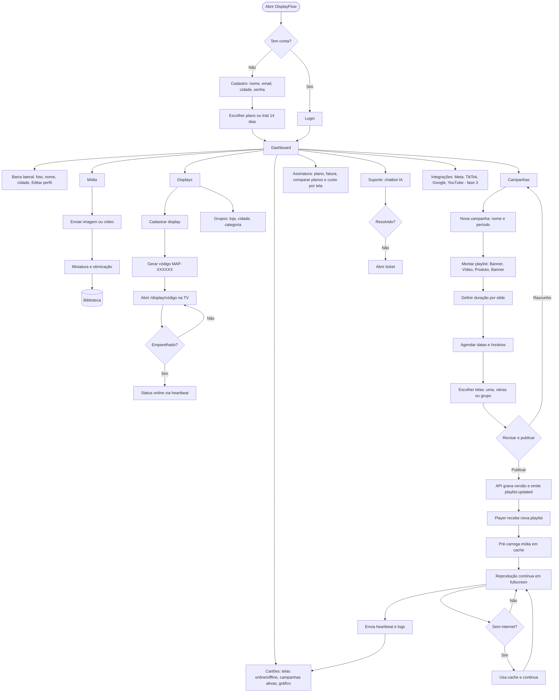

# DisplayFlow — PRD, Plano de Desenvolvimento, Schema e Fluxos

**Central de Publicidade Digital e Gestão de Telas** · Versão 1.4 · SaaS de assinatura mensal

---

## 0. Notas sobre o briefing

- O briefing menciona **viagens, roteiros e comparação de destinos**. Isso parece resto de outro modelo. O MVP do PDF é **Digital Signage**, por isso adaptei: "viagens/roteiros" vira **campanhas/playlists**, e "comparação de preços" vira **comparação de planos e custo por tela**.
- Não consigo fazer varredura de deep web. O benchmark abaixo vem de conhecimento de mercado (Yodeck, ScreenCloud, OptiSigns, Rise Vision, Screenly, Mvix, Xibo). Valide preços e funções atuais antes de decidir posicionamento.
- O link Base44 é uma SPA e não expôs conteúdo legível. A paleta v1 (marinho/ardósia, do PDF) foi **substituída na v1.1** pela do UI kit LMS: ver secção 10.

---

## 1. Visão e problema

**Visão:** controlar toda uma rede de telas a partir de um único painel.

**Problema:** empresas com várias TVs (lojas, clínicas, restaurantes, shoppings) atualizam cada ecrã à mão, com USB ou PC local. Não sabem se as telas estão ligadas, e não conseguem variar a campanha por local.

**Proposta:** painel web/mobile em nuvem + página de reprodução fullscreen (`/display/MAP-X7K92A`) que corre em qualquer navegador (Smart TV, Android Box, PC, tablet).

## 2. Personas

| Persona | Objetivo | Dor |
| --- | --- | --- |
| **Administrador da rede** (dono/gestor de marketing) | Publicar campanhas em N telas em minutos | Atualização manual, sem visibilidade |
| **Operador de loja** | Ligar a TV e ver conteúdo certo | Configuração técnica |
| **Anunciante** (fase 2) | Comprar espaço e ver relatório | Sem prova de exibição |
| **Gestor da plataforma (Super Admin)** | Gerir clientes, planos, cobrança | Sem visão financeira e de suporte |

## 3. Escopo do MVP (do PDF)

**Dentro:** biblioteca de mídia · campanhas com período · playlists com duração por slide · vídeo com avanço automático · displays com código exclusivo · grupos · publicação remota (tela, várias, grupo) · atualização em tempo real · agendamento · status online/offline · dashboard · player fullscreen.

**Fora (fases seguintes):** multi-empresa completa, analytics detalhado, app Android dedicado, layouts multi-zona, QR/feeds, sincronização frame-a-frame, integrações de anúncios.

## 4. Requisitos funcionais

| ID | Requisito | Prioridade |
| --- | --- | --- |
| RF-01 | Cadastro, login, recuperação de senha, perfil (foto, nome, cidade) | Must |
| RF-02 | Upload de imagem/vídeo para biblioteca, com pastas e tags | Must |
| RF-03 | Criar campanha (nome, período, estado: rascunho/ativa/pausada/agendada/terminada) | Must |
| RF-04 | Montar playlist: ordenar itens, duração por imagem, vídeo toca até ao fim | Must |
| RF-05 | Cadastrar display por **emparelhamento** (a TV mostra um código de 6 caracteres que o admin introduz no painel) ou por link `/display/{code}` | Must |
| RF-06 | Criar grupos (loja, cidade, categoria) e associar displays | Must |
| RF-07 | Publicar campanha em display(s) e/ou grupo(s) | Must |
| RF-08 | Display recebe alterações em tempo real (WebSocket, fallback polling 30 s) | Must |
| RF-09 | Agendamento por data e horário (ex.: 08h–12h) | Should |
| RF-10 | Status online/offline por heartbeat (offline após 90 s sem sinal) | Must |
| RF-11 | Player fullscreen, cache offline, retoma sozinho após queda | Must |
| RF-12 | Dashboard com telas online/offline, campanhas ativas, gráficos | Must |
| RF-13 | Assinatura mensal por nº de displays, com fatura | Must |
| RF-14 | Chatbot de suporte com IA (FAQ + abrir ticket) | Should |
| RF-15 | Papéis: Dono, Editor, Visualizador | Should |

## 5. Requisitos não funcionais

- **Desempenho:** painel \< 2 s; propagação de publicação \< 5 s nas telas online.
- **Resiliência:** player guarda a última playlist em cache e continua sem internet. Esta é crítica em redes instáveis.
- **Dados móveis:** vídeos comprimidos (H.264, 720p/1080p) e pré-carregados para poupar banda.
- **Segurança:** JWT + refresh, RBAC, URLs assinadas para mídia, código de display não adivinhável (6 caracteres alfanuméricos, rate-limit).
- **Escala:** multi-tenant desde o dia 1 (`organizationId` em tudo).
- **Acessibilidade:** contraste AA, navegação por teclado, responsivo 360 px → 4K.

## 6. Diferenciais e inovação

1. **Assistente IA de campanhas:** descreve-se a promoção em texto e a IA sugere playlist, durações e copy do banner.
2. **Modo "Loja instável":** cache inteligente + relatório de quando a tela ficou sem rede (mercados com conectividade variável).
3. **Emparelhamento por código:** a TV abre a URL, mostra um código de 6 caracteres e o admin apenas o introduz, sem instalar nada.
4. **Saúde da rede:** pontuação por tela (uptime, última atualização, erros de mídia).
5. **Comparador de planos e custo por tela** dentro da app.
6. **Hub de anúncios (Fase 3):** importar criativos e métricas de Meta Ads, TikTok Ads, Google Ads e YouTube para reaproveitar nas telas e comparar desempenho online vs. físico.
7. **Prova de exibição** (Fase 2): relatório de reproduções por tela, para vender espaço a anunciantes.

## 7. Modelo de negócio (assinatura recorrente)

| Plano | Displays | Armazenamento | Extras | Preço sugerido\* |
| --- | --- | --- | --- | --- |
| Starter | até 3 | 5 GB | 1 utilizador | \~15 USD/mês |
| Business | até 15 | 50 GB | agendamento, 5 utilizadores, chatbot | \~49 USD/mês |
| Network | até 60 | 250 GB | grupos avançados, analytics, API | \~149 USD/mês |
| Enterprise | ilimitado | sob medida | white-label, SLA | sob consulta |

\*Hipótese a validar. Preço por tela extra (\~4 USD). Pagamentos locais: M-Pesa, e-Mola, cartão (Stripe/Paddle onde disponível). Trial de 14 dias.

**Métricas:** MRR, churn, ARPA, telas ativas por cliente, tempo até primeira campanha publicada (meta \< 15 min).

## 8. Arquitetura e stack

```
Painel (Next.js + Tailwind, PWA)  ─┐
App mobile (PWA/React Native fase 2)├─► API (NestJS, REST + WebSocket) ─► PostgreSQL (Prisma)
Player /display/{code} (React leve) ─┘         │                      ├─► Redis (presença, pub/sub)
                                               ├─► S3/R2 + CDN (mídia)
                                               └─► Worker (transcodificação, agendador, cobrança)
```

- **Tempo real:** Socket.IO; o servidor emite `playlist:updated` para a sala `display:{id}`.
- **Status:** o player envia heartbeat a cada 30 s.
- **Mídia:** upload direto ao bucket por URL pré-assinada; worker gera miniatura e versão otimizada.
- **Hospedagem inicial:** Vercel + Railway/Render + Cloudflare R2 (baixo custo).

## 9. Roadmap

| Fase | Duração | Entrega |
| --- | --- | --- |
| **0 — Descoberta** | 1 sem | Validar com 3 a 5 lojas reais, fechar preço |
| **1 — MVP** | 6–8 sem | Auth, mídia, campanhas, playlists, displays, grupos, publicação, player, status, dashboard |
| **2 — Monetização** | 4 sem | Planos, cobrança, agendamento, papéis, chatbot, relatórios de reprodução |
| **3 — Escala** | 6 sem | Multi-empresa/anunciantes, integrações de anúncios, IA de campanhas |
| **4 — Player nativo** | 6 sem | App Android TV, layouts multi-zona, QR Codes, feeds, sincronização avançada |

## 10. Design (UI/UX) — Design System v2

Referência visual: UI kit "LMS / Student Portal" (paleta amostrada da imagem). Documento completo: **DisplayFlow_Design_System_v2.md**.

- **Estilo:** claro, calmo e arejado; fundo lavanda suave, cartões brancos com sombra mínima, cantos arredondados.
- **Paleta:** Índigo `#263DA7` (ação e destaque) · Tint `#E4EAFA` (seleção) · Fundo `#F8F9FD` · Cartão `#FFFFFF` · Borda `#E3E7F4` · Texto `#161B3D` · Secundário `#5E6485` · Sucesso `#3CAB89` · Alerta `#EFAF4F` · Erro `#E65B64`. Há versão escura.
- **Tipografia:** Inter (única família).
- **Barra lateral clara:** logo, menu com item ativo em pílula azul-clara, e no rodapé foto, nome, cidade e **Editar perfil**.
- **Dashboard:** saudação, 5 cartões (o primeiro em índigo), status dos displays, campanhas ativas, gráfico de reproduções.
- **Editor de campanha:** dados, destinos e horários à esquerda; playlist com miniaturas, ordem e duração à direita.

## 11. Schema Prisma (v1.4)

```prisma
generator client {
  provider = "prisma-client-js"
}

datasource db {
  provider = "postgresql"
  url      = env("DATABASE_URL")
}

enum Role              { OWNER EDITOR VIEWER SUPER_ADMIN }
enum MediaType         { IMAGE VIDEO YOUTUBE }
enum CampaignStatus    { DRAFT SCHEDULED ACTIVE PAUSED ENDED }
enum Transition        { NONE FADE SLIDE }
enum DisplayStatus     { PENDING ONLINE OFFLINE }
enum TargetType        { DISPLAY GROUP }
enum PlaybackEventType { START END ERROR }
enum SubStatus         { TRIALING ACTIVE PAST_DUE CANCELED }
enum TicketStatus      { OPEN PENDING RESOLVED }
enum AdPlatform        { META TIKTOK GOOGLE YOUTUBE }
enum InvoiceStatus     { PENDING PAID FAILED VOID REFUNDED }
enum MediaStatus       { PROCESSING READY FAILED }

model User {
  id           String   @id @default(cuid())
  email        String   @unique
  passwordHash String
  name         String
  city         String?
  avatarUrl    String?
  createdAt    DateTime @default(now())
  memberships  Membership[]
  tickets      SupportTicket[]
}

model Organization {
  id              String   @id @default(cuid())
  name            String
  slug            String   @unique
  timezone        String   @default("Africa/Maputo")
  defaultSlideSec Int      @default(10)
  alertEmail      String?
  alertWebhookUrl String?
  alertAfterMin   Int      @default(10)
  createdAt       DateTime @default(now())
  memberships     Membership[]
  media           MediaAsset[]
  campaigns       Campaign[]
  displays        Display[]
  groups          DisplayGroup[]
  subscription    Subscription?
  integrations    AdIntegration[]
  tickets         SupportTicket[]
  ticketCalls     TicketCall[]
}

model Membership {
  id     String @id @default(cuid())
  role   Role   @default(EDITOR)
  userId String
  orgId  String
  user   User         @relation(fields: [userId], references: [id], onDelete: Cascade)
  org    Organization @relation(fields: [orgId], references: [id], onDelete: Cascade)
  @@unique([userId, orgId])
}

model MediaAsset {
  id           String    @id @default(cuid())
  orgId        String
  name         String
  originalName String?
  type         MediaType
  mimeType     String?
  url          String
  thumbUrl     String?
  sizeBytes    Int
  width        Int?
  height       Int?
  durationSec  Int?
  tags         String[]
  status       MediaStatus @default(READY)
  processError String?
  createdAt    DateTime  @default(now())
  org          Organization @relation(fields: [orgId], references: [id], onDelete: Cascade)
  items        PlaylistItem[]
  @@index([orgId, type])
}

model Campaign {
  id         String         @id @default(cuid())
  orgId      String
  name       String
  status     CampaignStatus @default(DRAFT)
  priority   Int            @default(0)
  transition Transition     @default(FADE)
  widgets    Json           @default("{}") // { ticker?, qr?, product?, clock? } (portado do Signage.Pro)
  startsAt   DateTime?
  endsAt     DateTime?
  version    Int            @default(1)
  createdAt  DateTime       @default(now())
  updatedAt  DateTime       @updatedAt
  org        Organization   @relation(fields: [orgId], references: [id], onDelete: Cascade)
  items      PlaylistItem[]
  targets    CampaignTarget[]
  schedules  Schedule[]
  @@index([orgId, status])
}

model PlaylistItem {
  id          String   @id @default(cuid())
  campaignId  String
  mediaId     String
  position    Int
  durationSec Int      @default(10)
  campaign    Campaign   @relation(fields: [campaignId], references: [id], onDelete: Cascade)
  media       MediaAsset @relation(fields: [mediaId], references: [id])
  @@unique([campaignId, position])
}

model Schedule {
  id         String   @id @default(cuid())
  campaignId String
  daysOfWeek Int[]
  startTime  String
  endTime    String
  campaign   Campaign @relation(fields: [campaignId], references: [id], onDelete: Cascade)
}

model Display {
  id            String        @id @default(cuid())
  orgId         String
  name          String
  code          String        @unique
  location      String?
  status        DisplayStatus @default(PENDING)
  lastSeenAt    DateTime?
  playerVersion String?
  platform      String?
  resolution    String?
  pairedAt      DateTime?
  offlineAlertedAt DateTime?
  outages       DisplayOutage[]
  deviceSecretHash String? @unique // sha256 do segredo guardado na TV; null = não emparelhada
  createdAt     DateTime      @default(now())
  org           Organization  @relation(fields: [orgId], references: [id], onDelete: Cascade)
  groups        DisplayGroupMember[]
  targets       CampaignTarget[]
  events        PlaybackEvent[]
  @@index([orgId, status])
}

model DisplayGroup {
  id      String  @id @default(cuid())
  orgId   String
  name    String
  kind    String?
  org     Organization @relation(fields: [orgId], references: [id], onDelete: Cascade)
  members DisplayGroupMember[]
  targets CampaignTarget[]
}

model DisplayGroupMember {
  displayId String
  groupId   String
  display   Display      @relation(fields: [displayId], references: [id], onDelete: Cascade)
  group     DisplayGroup @relation(fields: [groupId], references: [id], onDelete: Cascade)
  @@id([displayId, groupId])
}

model CampaignTarget {
  id         String     @id @default(cuid())
  campaignId String
  type       TargetType
  displayId  String?
  groupId    String?
  campaign   Campaign      @relation(fields: [campaignId], references: [id], onDelete: Cascade)
  display    Display?      @relation(fields: [displayId], references: [id], onDelete: Cascade)
  group      DisplayGroup? @relation(fields: [groupId], references: [id], onDelete: Cascade)
}

model PlaybackEvent {
  id         String            @id @default(cuid())
  displayId  String
  campaignId String
  mediaId    String
  type       PlaybackEventType
  durationMs Int?
  createdAt  DateTime          @default(now())
  display    Display           @relation(fields: [displayId], references: [id], onDelete: Cascade)
  @@index([displayId, createdAt])
}

model Plan {
  id            String @id @default(cuid())
  name          String @unique
  priceCents    Int
  maxDisplays   Int
  storageGb     Int
  maxUsers      Int
  features      Json
  subscriptions Subscription[]
}

model Subscription {
  id        String    @id @default(cuid())
  orgId     String    @unique
  planId    String
  status    SubStatus @default(TRIALING)
  trialEnds DateTime?
  cancelAtPeriodEnd Boolean @default(false)
  renewsAt  DateTime?
  org       Organization @relation(fields: [orgId], references: [id], onDelete: Cascade)
  plan      Plan         @relation(fields: [planId], references: [id])
  invoices  Invoice[]
}

model Invoice {
  id             String        @id @default(cuid())
  subscriptionId String
  planName       String
  amountCents    Int
  currency       String        @default("USD")
  status         InvoiceStatus @default(PENDING)
  provider       String?
  providerRef    String?
  providerTxId   String?
  refundRef      String?
  refundedAt     DateTime?
  periodStart    DateTime?
  periodEnd      DateTime?
  createdAt      DateTime      @default(now())
  paidAt         DateTime?
  subscription   Subscription  @relation(fields: [subscriptionId], references: [id], onDelete: Cascade)
  @@index([subscriptionId, status])
}

// Emparelhamento: a TV pede um código curto; o admin reclama-o no painel.
model DevicePairing {
  id          String    @id @default(cuid())
  pairingCode String    @unique
  secretHash  String
  platform    String?
  userAgent   String?
  expiresAt   DateTime
  displayId   String?
  claimedAt   DateTime?
  createdAt   DateTime  @default(now())
  @@index([secretHash])
  @@index([expiresAt])
}

model AdIntegration {
  id          String     @id @default(cuid())
  orgId       String
  platform    AdPlatform
  accountId   String
  accessToken String
  createdAt   DateTime   @default(now())
  org         Organization @relation(fields: [orgId], references: [id], onDelete: Cascade)
  @@unique([orgId, platform, accountId])
}

model SupportTicket {
  id         String       @id @default(cuid())
  orgId      String
  userId     String
  subject    String
  status     TicketStatus @default(OPEN)
  transcript Json?
  createdAt  DateTime     @default(now())
  org        Organization @relation(fields: [orgId], references: [id], onDelete: Cascade)
  user       User         @relation(fields: [userId], references: [id])
}

// Chamada de senhas (portado do Signage.Pro): evento em tempo real + histórico
model TicketCall {
  id         String   @id @default(cuid())
  orgId      String
  number     String
  desk       String?
  displayIds String[]
  createdBy  String?
  createdAt  DateTime @default(now())
  org        Organization @relation(fields: [orgId], references: [id], onDelete: Cascade)
  @@index([orgId, createdAt])
}

// Quebras de sinal (para alertas e disponibilidade)
model DisplayOutage {
  id        String    @id @default(cuid())
  displayId String
  startedAt DateTime
  endedAt   DateTime?
  display   Display   @relation(fields: [displayId], references: [id], onDelete: Cascade)
  @@index([displayId, startedAt])
}
```

## 12. Flowchart UX



## 13. Riscos e mitigação

| Risco | Mitigação |
| --- | --- |
| Smart TVs com navegador fraco | Testar em 3 a 4 modelos; player leve; Android Box recomendado |
| Internet instável | Cache offline e pré-carregamento |
| Custo de armazenamento e banda de vídeo | Transcodificação, limites por plano, CDN |
| Pagamentos locais | M-Pesa/e-Mola via agregador; faturação manual no início |
| Conformidade de conteúdo | Termos de uso e logs de quem publicou |

## 14. Próximos passos

1. Validar o MVP com 3 a 5 clientes reais e fechar os preços.
2. Criar o repositório (monorepo: `web`, `api`, `player`), aplicar o schema com `prisma migrate dev`.
3. Construir na ordem: Auth → Mídia → Displays → Campanhas → Publicação + Player → Dashboard.
4. Usar o protótipo interativo anexo como referência de UX.

## 15. Integração técnica com as TVs

**Decisão:** sem SDK nativo no MVP. Um **player web hospedado (PWA)** + instaladores finos por plataforma (quiosque Linux/Windows, APK Android TV, apps Tizen/webOS depois). O conteúdo e a lógica ficam no servidor.

- **Dois canais:** controlo (HTTPS + WebSocket, leve) e mídia (download HTTPS antes de ser preciso, guardado no aparelho). Não é transmissão ao vivo.
- **Emparelhamento:** a TV pede um código de 6 caracteres (10 min, uso único); o admin introduz-o em *Displays → Emparelhar tela*; a TV recebe um token próprio (o servidor guarda só o hash) e é revogável por tela.
- **Resiliência:** última playlist e mídia em cache; funciona sem internet; heartbeat de 30 s; estado Offline após 90 s.
- **Equipamento de referência:** box Android TV (Android 9+, 2 GB RAM, H.264 1080p) ou mini PC. Smart TVs de consumo não garantem quiosque.
- **Mídia:** MP4 H.264 1080p30, até 8 Mbps, `faststart`; vídeos até \~60 s.
- **Estado:** tudo escrito, **nada testado em aparelho real**. Detalhe, protocolo e plano de testes em *DisplayFlow_Integracao_TVs.md*.

## 16. Cobrança e planos

- **Modelo:** assinatura mensal por plano (Starter, Business, Network), ciclo de 30 dias, teste grátis de 14 dias.
- **Limites aplicados no servidor:** nº de displays, armazenamento, utilizadores, agendamento por horário (a partir de Business).
- **Estados:** Teste grátis → Ativa → Em atraso → Cancelada. Em atraso, as telas continuam a mostrar o publicado, mas não se publica nem se emparelha.
- **Mudança de plano:** aplica-se após o pagamento, novo ciclo, sem proração (MVP). Só se pode descer se o uso couber no plano de destino.
- **Pagamento:** **M-Pesa** (cobrança, consulta, reversão) e **cartão (Stripe)** implementados e testados contra simulações; `manual` como alternativa. Falta o sandbox e o Go Live do M-Pesa e uma conta Stripe. **e-Mola está bloqueado**: a API da Movitel é privada. Ver *DisplayFlow_Pagamentos_e_Validacao.md*.
- **Painel:** Configurações → Assinatura mostra plano, uso, planos, faturas, cancelar/retomar.

## 17. Funcionalidades do Signage.Pro integradas

Foco do produto: controlar remotamente qualquer tela e enviar imagens, vídeos do YouTube, QR Codes, letreiros e destaques de produto em tempo real.

| Funcionalidade | Onde |
| --- | --- |
| Vídeo do YouTube | Item de playlist (`YOUTUBE`), duração definida; precisa de internet na TV |
| Letreiro, QR Code, destaque de produto, relógio | Sobreposições por campanha (`Campaign.widgets`) |
| Chamada de senhas com som | Página Senhas, evento em tempo real, histórico |

**Segurança:** o Signage.Pro original usa regras Firebase de leitura e escrita públicas e o id do administrador como segredo do URL da TV. Nada disso foi trazido: o DisplayFlow usa JWT, dados por organização e token revogável por tela. Detalhe em *DisplayFlow_MPesa_e_SignagePro.md*.

## 18. Operação, análise e suporte

- **Analytics:** reproduções, erros, tempo no ar, por dia, hora, mídia, campanha e tela; disponibilidade por tela; CSV. 7 dias em todos os planos; 30 e 90 dias no Network.
- **Alertas de tela offline:** email (Resend) e webhook com proteção anti-SSRF; um aviso por incidente e aviso de recuperação; as quebras alimentam a disponibilidade.
- **Vídeo:** conversão automática para H.264 1080p com faststart e poster, em fila; estados A processar, Pronto e Falhou; só mídia pronta entra em campanhas.
- **Suporte:** assistente por base de conhecimento (todos os planos) e por IA restrita a essa base nos planos com chatbot; abre pedidos de suporte com a conversa anexada.
- **Qualidade:** 67 testes automáticos (lógica pura, ffmpeg real, E2E em Chromium) e CI. O relatório de validação lista o que **não** foi verificado.

## 19. Estado do projeto

| Área | Estado |
| --- | --- |
| Painel, API, player, landing, Design System | Escritos; lógica e player testados; **não compilados com os pacotes reais** |
| M-Pesa, Stripe | Testados contra simulações; **sem credenciais, não validados com os fornecedores** |
| e-Mola | **Bloqueado** (especificação privada da Movitel) |
| TVs reais, APK Android, Tizen, webOS | **Não testados** |
| Base de dados | Schema consistente; **migração nunca executada contra Postgres** |